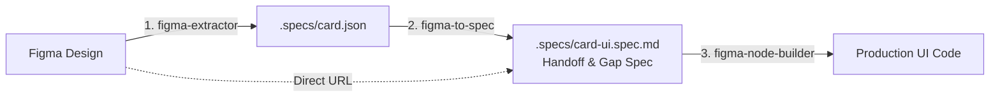

# Figma To Spec

An AI coding agent skill that turns Figma URLs or extracted Figma JSON specifications (`.specs/*.json`) into structured, human- and agent-readable **Markdown specifications** (`.specs/<name>-ui.spec.md`, or `.specs/ui.spec.md` when unnamed) for technical UI handoff, gap analysis, and functional documentation — **without writing application code**.

This skill serves as the **Specification & Handoff Layer** in a **Spec-Driven Development (SDD)** workflow, sitting cleanly between [`figma-extractor`](../figma-extractor) and [`figma-node-builder`](../figma-node-builder).

---

## Why `figma-to-spec`?

Machine-readable `.specs/*.json` ASTs are ideal for automated UI synthesis, but hard for engineers, PMs, QA, or planning agents to review directly. **`figma-to-spec`** bridges that gap:

- **Dual Input**: Accepts either a **local `.specs/<name>.json`** (100% offline, 0 API calls) or a **Figma URL** (fetches once under the Zero-Hammer Protocol and caches `.specs/<name>.json`).
- **Dual Mode (Codebase-Aware + Standalone)**:
  - Inside an application project, it discovers your stack, UI primitives, theme tokens, and icon libraries to produce a **Codebase Mapping & Gap Analysis** section.
  - Outside a project (or when requested), it produces a clean standalone design & functional spec.
- **Strict Read-Only / Spec-Only Boundary**: Never creates or modifies application source code (`.tsx`, `.vue`, `.css`, etc.).
- **Zero External Dependencies**: Uses Node.js built-ins only (`fs`, `path`, `https`, `http`, `os`, `url`).

---

## How It Fits into SDD



1. **Ingest (`figma-extractor`)**: Extracts the pruned AST JSON to `.specs/<name>.json` (or export offline via the [Node JSON Extractor](https://www.figma.com/community/plugin/1691244420692136789/node-json-extractor) plugin).
2. **Document & Plan (`figma-to-spec`)**: Synthesizes `.specs/<name>-ui.spec.md` (or `.specs/ui.spec.md` when unnamed) with layout hierarchy, full copy inventory, component props matrix, tokens, assets, and codebase gap analysis. *(Also works directly from a Figma URL.)*
3. **Implement (`figma-node-builder`)**: Builds grounded UI code from the approved spec.

---

## What Goes Into `.specs/<name>-ui.spec.md`

1. **Overview**: Root frame name, dimensions, layout mode, source links, and functional goal.
2. **Functional & Content Breakdown**: User-facing regions, complete copy/text inventory, interactive elements, and inferred UI states.
3. **Layout & Structure Tree**: Indented container hierarchy with `layoutMode`, gaps, padding, alignment, and sizing.
4. **Component Inventory**: Every `INSTANCE` node, occurrence counts, and normalized variant/prop combinations.
5. **Design Tokens & Visual System**: Semantic tokens vs raw hex colors, spacing/radii tokens, typography scale, effects, normalized icon list, and image layers.
6. **Codebase Mapping & Implementation Gaps** *(Codebase Mode)*: Reuse mapping against existing project components/tokens/icons, missing items (`TODO`s), and an implementation checklist.

---

## How to Use the Skill

Prompt your AI coding assistant (Claude Code, Kiro, Cursor, OpenCode, Codex, or Antigravity):

```text
"Summarize .specs/checkout.json into a technical UI handoff spec in .specs/checkout-ui.spec.md and list any missing components in our codebase."
```

Or directly from a Figma link:

```text
"Create a Markdown specification from this Figma screen so we can review layout, copy, tokens, and gaps before coding: https://www.figma.com/design/..."
```

---

## Spec Analyzer CLI (`analyze_spec.js`)

Run the zero-dependency analyzer directly from the terminal to inspect or scaffold Markdown specs from any `.specs/*.json` file:

```bash
# Terminal summary
node figma-to-spec/scripts/analyze_spec.js .specs/card.json
# (or shorthand)
node figma-to-spec/scripts/analyze_spec.js card

# Print structured Markdown specification scaffold to stdout
node figma-to-spec/scripts/analyze_spec.js card --markdown

# Write Markdown scaffold directly to default path (.specs/card-ui.spec.md)
node figma-to-spec/scripts/analyze_spec.js card --markdown --output

# Or write to a custom path
node figma-to-spec/scripts/analyze_spec.js card --markdown --output .specs/ui.spec.md

# Print full structured JSON analysis (tree, copy, instances, tokens, icons, images)
node figma-to-spec/scripts/analyze_spec.js card --json

# Limit layout tree depth or omit tree
node figma-to-spec/scripts/analyze_spec.js card --markdown --max-depth 4
node figma-to-spec/scripts/analyze_spec.js card --markdown --no-tree
```

All CLI flags for both `analyze_spec.js` and `fetch_figma.js`, plus OS token setup and SSL proxy options, are documented in [REFERENCE.md](REFERENCE.md).
