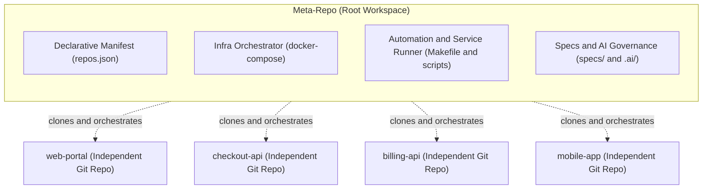
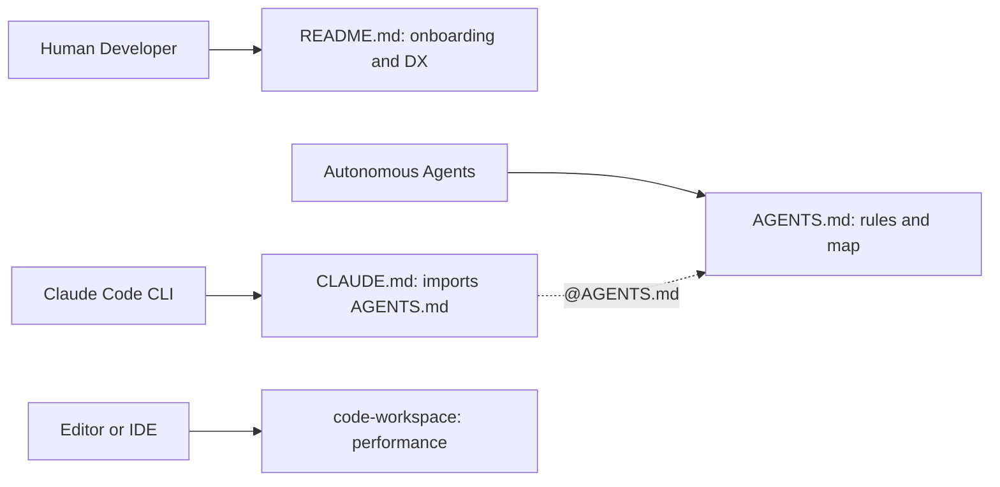

# Meta-Repo Architecture: Reference Guide and Implementation Blueprint

> This document describes the **Manifest-based Multi-root Workspace (Meta-Repo)** architectural pattern in a company- and product-agnostic way. It serves as a technical specification to design, operate, and replicate this architecture across any group of heterogeneous repositories.

> [!NOTE]
> **Fictional organization used in examples**: every example in this guide uses the same fictional organization, **Acme**, with the repositories below. Replace them with your own.
>
> | Repository | Path | Stack | Category | Product | Port | Execution |
> | :--- | :--- | :--- | :--- | :--- | :---: | :---: |
> | `web-portal` | `apps/web-portal` | Next.js | `frontend` | `checkout` | 3000 | host |
> | `mobile-app` | `apps/mobile` | React Native | `frontend` | `checkout` | — | — |
> | `checkout-api` | `services/checkout` | Node.js | `backend` | `checkout` | 4001 | docker |
> | `billing-api` | `services/billing` | Go | `backend` | `billing` | 4002 | docker |
> | `shared-libs` | `libs/shared` | Turborepo | `library` | — | — | — |
> | `legacy-monolith` | `legacy/monolith` | PHP | `legacy` | — | 8080 | — |

---

## Table of Contents

1. Overview and Architectural Philosophy
2. When to Adopt (Decision Criteria)
3. Structural Characteristics
4. Native Architectural Design Patterns
5. Workspace Command Dictionary
6. Step-by-Step Replication Blueprint
7. Guidelines and Anatomy of Entry Files (`README.md`, `AGENTS.md`, `CLAUDE.md`, `*.code-workspace`)
8. Compatibility and Alternative Tools

---

## 1. Overview and Architectural Philosophy

On the spectrum between **Pure Monorepos** (all code in a single Git repository) and **Isolated Multi-repos** (dozens of independent repositories without orchestration), the **Meta-Repo** emerges as a pragmatic middle ground.



### What is the pattern?
A Meta-Repo is a central Git repository that contains no service business logic. Instead, it acts as the organization's **governance shell, local environment orchestrator, and technical specification hub**.

Unlike `git submodule` approaches (which frequently suffer from detached HEADs and pointer merge conflicts), the Meta-Repo adopts a **declarative manifest-based model**:
1. The root repository maintains a manifest (`repos.json`) listing repositories, paths, ports, categories, and remotes. **It is the single source of truth.**
2. The root `.gitignore` ignores the directories where subprojects are cloned.
3. Scripts automate cloning, updating, and integrity checks across all repositories.
4. An IDE workspace file connects all folders into a single navigation tree with global indexing.

---

## 2. When to Adopt (Decision Criteria)

Evaluate before implementing:

| Decision Question | Adopt Meta-Repo? | Notes |
| :--- | :---: | :--- |
| Do teams use heterogeneous technologies (Node, Go, Python, C#, PHP)? | **Yes** | Traditional monorepos struggle to integrate disparate build toolchains. |
| Do services have independent deploy lifecycles and ownership? | **Yes** | Each repository preserves its own CI/CD and permissions. |
| Do you need a reproducible development environment with a few commands? | **Yes** | The pattern eliminates onboarding friction. |
| Dozens of existing repositories cannot be merged (history, compliance, permissions)? | **Yes** | The meta-repo organizes them without migrating Git history. |
| Are all services TypeScript/JavaScript sharing dense code daily? | **No** | A pure monorepo with pnpm Workspaces + Turborepo/Nx is usually a better fit. |
| Are atomic cross-repo changes (a single commit touching multiple services) frequent and non-negotiable? | **No** | Consider a monorepo; a meta-repo relies on the Expand/Contract pattern (Section 4.1). |

---

## 3. Structural Characteristics

A modern Meta-Repo implements the following core capabilities:

*   **Autonomy with True Decoupling**: Each service keeps its own lifecycle, CI/CD pipelines, access permissions, and versioning, without monorepo merge trains.
*   **Conflict-Free Polyglot Stacks**: Services in heterogeneous languages and frameworks (Node.js, Go, Python, C#, React Native, Kubernetes manifests) coexist in the same development environment without dependency conflicts or a single forced build tool.
*   **Hybrid Execution Environment**: Infrastructure and backend services run in Docker containers (OS parity), while frontends and mobile apps run natively on the host (low-latency hot-reload and lower resource usage).
*   **Spec-Driven Engineering**: End-to-end technical specifications live centrally at the root (`specs/`), acting as the single source of truth for features spanning multiple services.
*   **Centralized Organizational Documentation (`docs/`)**: High-level architecture views, ADRs (*Architecture Decision Records*), C4 diagrams, and operational runbooks, preventing holistic knowledge from scattering across individual repositories.
*   **Native AI Governance (`AGENTS.md`, `CLAUDE.md`, and `.ai/`)**: Architectural rules, file size limits (LOC), coding standards, roles, and AI commands reside at the root and are distributed to tools like Claude Code, Windsurf, Cursor, and CLI assistants:
    *   `AGENTS.md`: Standard contract for autonomous agents (Antigravity, Cursor, Windsurf, Copilot). It is **layered**: one at the root with global rules and one in each subrepo with local commands and exceptions (Section 7.2).
    *   `CLAUDE.md`: Entry point for Claude Code CLI. It **imports** `AGENTS.md` rather than duplicating it (Section 7.3).
*   **Organization-Specific CLI**: A global command (e.g., `acme status`, `acme run`) that works from **any subdirectory**, interactively installed into the developer's shell (Section 6, Step 6).

### 3.1. Subproject Autonomy Principle (Zero Lock-in)

> [!IMPORTANT]
> **The Meta-Repo is additive, never restrictive.** It adds a convenience layer for orchestration, governance, and integrated development, but **never strips away any property of a standalone repository**.

*   **Every subproject works outside the meta-repo**: `git clone`, installing dependencies, and running the service must work in isolation without depending on the workspace folder layout.
*   **Relative imports across repository boundaries are forbidden** (e.g., `import "../../libs/shared"`). Shared code is distributed via versioned packages or generated contracts (Section 4.2).
*   **Optional IDE focus**: developers working on a single repository can open just that folder (`code apps/web-portal`) without loading the entire workspace.
*   **Commits always happen at the subproject root**: a subproject's Git history never receives files from the meta-repo, and vice versa.

---

## 4. Native Architectural Design Patterns

When designing a new Meta-Repo, the classic challenges of distributed repositories should be solved structurally from day one.

### 4.1. Cross-Repo Changes (Expand/Contract Pattern)
Because there are no atomic commits spanning multiple repositories simultaneously, direct breaking changes to API contracts or database schemas are forbidden:

1. **Phase 1 (Expand)**: The producer service adds new fields or routes while maintaining full backward compatibility. Deployed to production in isolation.
2. **Phase 2 (Migrate)**: Consumer services are gradually updated to use the new version.
3. **Phase 3 (Contract)**: Obsolete code or fields are removed from the producer in a later cycle.

> [!TIP]
> **Branch Naming by Specification ID**: For features spanning multiple repositories, use the same branch name across all of them (e.g., `feat/SPEC-042-billing-overhaul`). That way, `make checkout BRANCH=...` switches the entire ecosystem at once, and CI automations can automatically link sibling branches.

### 4.2. Typed Contracts and Compile-Time Validation
*   Publish contracts from a language-neutral specification (**OpenAPI**, **Protobuf/gRPC**, or **GraphQL**) and generate typed clients for each consumer stack (e.g., TypeScript types, Go structs).
*   Shared libraries (e.g., `libs/shared`) are distributed as **versioned packages** in a registry, never via relative file paths.
*   Result: contract breakages are caught during the consumer's static typecheck/compilation (`tsc`, `go build`) before deployment.

### 4.3. Resource Efficiency and Local Performance
To prevent multiple projects from exhausting developer RAM and disk space:

*   **Selective Cloning and Flexible Taxonomy**: The manifest should not enforce a rigid structure; repository categorization should reflect the organization's actual topology. Combine freely:
    *   *By Product or Business Domain* (`product` field, e.g., `checkout`, `billing`): vertical squads clone only their product line (`make bootstrap-product PRODUCT=checkout`).
    *   *By Technical Layer* (`category` field, e.g., `frontend`, `backend`, `library`): frontend engineers download only UI applications (`make bootstrap-frontend`) and consume APIs via containers or shared environments.
    *   *By Lifecycle* (`legacy` category): legacy repositories are **excluded from the default bootstrap** and only cloned on demand (`make bootstrap-legacy`).
*   **Content-Addressable Storage (CAS)**: Standardize on package managers that share global physical disk storage (such as `pnpm`), avoiding duplicate `node_modules` across repositories.
*   **Language Server Optimization**: Configure `*.code-workspace` to exclude build and dependency folders from indexing and file watchers (Section 7.4).

### 4.4. Single Source of Truth (Manifest)
Ports, paths, and categories often scatter across Makefiles, `docker-compose`, READMEs, `.gitignore`, and `code-workspace`, inevitably drifting apart. The rule is:

*   **`repos.json` is the single source of truth.** The Makefile **derives** repository paths from the manifest; the service runner reads ports and execution modes directly from it.
*   Other files (`.gitignore`, workspace `folders`, README port tables) are **validated** against the manifest by `make check-manifest`, running both locally and in CI (Section 6, Step 9).
*   Convention: every service name in `docker-compose.dev.yml` **matches** the repository's `name` in the manifest.

### 4.5. Reproducibility (Version Pinning)
*   Each manifest entry can declare `branch` (default working branch, defaults to `main`) and, optionally, `ref` (pinned tag or commit SHA).
*   Use `ref` to freeze the ecosystem at a known state (e.g., reproducing a bug from release `v2.3`).
*   Suggested advanced command: `make snapshot`, which records the current SHAs of all repositories into `repos.lock.json`, similar to Google's `repo manifest -r`.

### 4.6. Companion IaC / Deploy Repositories (Parent Grouping Folder Pattern)
When every application or service repository has a dedicated sibling repository for Infrastructure-as-Code or GitOps deployment (`*-iac`, `*-deploy`, `*-infra` in Terraform, Helm, Kustomize, Pulumi, or CDK):

*   **Never nest one Git repository inside another**: cloning `frontend-iac` inside the `frontend` Git working tree would pollute `frontend`'s `git status` and `.gitignore`.
*   **Group pairs inside a neutral parent folder (pseudo-folder)**: place the code repository and its companion IaC/deploy repository side-by-side inside a plain parent directory (which has no `.git` of its own):
    ```text
    apps/frontend/                      # Neutral parent folder (no .git)
    ├── frontend/                       # Git repo 1: application code (category: "frontend")
    └── frontend-iac/                   # Git repo 2: IaC / deploy manifests (category: "iac")
    ```
    *(Or at the top level as `frontend/frontend` and `frontend/frontend-iac`, with `/frontend/` in the root `.gitignore`).*
*   **Manifest Pairing & Selective Cloning**:
    *   Assign `"category": "iac"` (or `"deploy"` / `"infra"`), the same `"product"` as the sibling service, and optional `"companion": "frontend-iac"` / `"companionOf": "frontend"` fields in `repos.json`.
    *   `make bootstrap-product PRODUCT=checkout` clones both the application and its IaC sibling together; `make bootstrap-iac` (`node scripts/bootstrap.mjs --category=iac`) clones only IaC repositories across the organization.
*   **IDE Pseudo-Folder View (`*.code-workspace`)**: point a single `folders` entry in `.code-workspace` to the neutral parent folder (`{ "name": "Frontend (Next.js + IaC)", "path": "apps/frontend" }`) and set `"git.autoRepositoryDetection": "subFolders"` in `settings` so the editor displays a single root tree node while tracking both Git repositories independently.

---

## 5. Workspace Command Dictionary

> [!TIP]
> After configuring the organization CLI (`make setup-cli`), any `make <command>` can be invoked as `<cli> <command>` (e.g., `acme status`) from **any subdirectory**.

Commands are split into **Essential Commands** (implemented in Section 6's Blueprint) and **Advanced Commands** (optional extensions tailored to the organization).

### 5.1. Essential Commands (Implemented in the Blueprint)

#### Setup and Bootstrap

| Command | What it does | Purpose | When to use |
| :--- | :--- | :--- | :--- |
| `make help` | Displays a colored list of all documented commands (default Makefile target). | Quick command discovery without opening documentation. | Whenever you are unsure about available commands or syntax. |
| `make bootstrap` | Clones or updates active repositories (legacy excluded by default). | Set up the primary working tree without wasting disk space on legacy code. | Standard onboarding for a new developer. |
| `make bootstrap-frontend` | Clones only repositories in the `frontend` category. | Allows UI developers to work without cloning backend repositories. | When working strictly on frontend or UI tasks. |
| `make bootstrap-product PRODUCT=<name>` | Clones only repositories belonging to a product (e.g., `PRODUCT=checkout`). | Isolates the workspace for vertical product squads. | When teams are organized around independent product lines. |
| `make bootstrap-legacy` | Clones only repositories in the `legacy` category. | Enables occasional fixes in legacy systems without forcing everyone to keep them locally. | During sporadic maintenance of legacy systems. |
| `make bootstrap-all` | Clones every repository in the manifest, including legacy ones. | Full view of the organizational ecosystem. | For architects, platform engineers, or full CI pipelines. |
| `make bootstrap-https` | Same as `bootstrap`, using HTTPS instead of SSH. | Fallback for machines without SSH keys or behind restrictive proxies. | In temporary containers or restrictive corporate networks. |
| `make bootstrap ARGS="--dry-run"` | Previews what would be cloned/updated without executing. Accepts any script flag (`--category=`, `--product=`, `--all`). | Simulate and verify filters before running. | Before a large bootstrap or in CI scripts. |
| `make install` | Installs dependencies in each cloned repository, detecting the ecosystem by lockfile (`pnpm-lock.yaml`, `go.mod`). | Prepare all projects in one go. | After initial bootstrap or after pulls that modified dependencies. |
| `make setup-cli` | Interactive installer that detects the shell (zsh, bash, fish), defaults to the meta-repo name, and lets the user pick a custom alias. | Run `<cli> <command>` from any subdirectory. | Once, during initial machine setup. |
| `make remove-cli` | Removes the CLI block from the shell configuration file. | Uninstall or rename the CLI command. | When renaming the CLI or cleaning up the environment. |
| `make check-manifest` | Validates `repos.json` (required fields, naming, duplicates) and verifies every path is covered by `.gitignore`. | Enforce the single source of truth and prevent accidentally committing subprojects. | When editing the manifest; also runs automatically in CI. |

#### Service Execution

| Command | What it does | Purpose | When to use |
| :--- | :--- | :--- | :--- |
| `make dev-infra` | Starts only database, cache, and messaging containers in the background, waiting for healthchecks. | Provide base infrastructure without spending CPU on application services. | At the start of the workday; data persists across service restarts. |
| `make run` | Without arguments, lists runnable services with path, port, and mode (docker/host) from the manifest. | Quick endpoint lookup. | To check which port each service listens on. |
| `make run S="checkout-api web-portal"` | Starts selected services: `docker` ones via Compose and `host` ones via their manifest `dev` command. `Ctrl+C` stops all of them. | Run only the slice of the stack needed for the flow under test. | Throughout daily feature development. |
| `BUILD=1 make run S="..."` | Forces Docker image rebuilds before starting services. | Rebuild containers after `Dockerfile` or dependency changes. | Whenever native dependencies or container configs change. |
| `make dev-logs` | Follows unified container logs (`docker compose logs -f`). | Debug requests flowing across multiple services. | During end-to-end debugging. |
| `make dev-down` | Stops all containers while preserving data volumes. | Free memory and CPU. | At the end of the day or when switching projects. |
| `make dev-down-v` | Stops all containers **and removes volumes** (clean slate). | Reset databases and queues to a clean state. | When local state or migrations become corrupted. |

#### Batch Git Operations

| Command | What it does | Purpose | When to use |
| :--- | :--- | :--- | :--- |
| `make pull` | Runs `git pull --rebase --autostash` in every cloned repository, reporting failures without aborting the batch. | Sync the entire workspace with remotes. | At the start of the day or before starting a new task. |
| `make status` | Shows short git status and active branch for each repository. | Quickly see which repositories have local changes. | Before ending a session, switching tasks, or committing. |
| `make branches` | Prints a table with the active branch of each repository. | Prevent accidental commits to the wrong branch. | While working on multi-repository features. |
| `make checkout BRANCH=<name>` | Switches to the branch in every repository where it exists (local or remote) and reports where it does not. | Switch context across the entire ecosystem at once. | When starting or resuming a cross-repo feature. |
| `make sync-main` | Updates each repository's default branch (detected via `origin/HEAD`): `pull --ff-only` if currently checked out, `fetch origin <b>:<b>` otherwise. | Keep base branches up to date without leaving your working branch. | Daily or before branching new work. |
| `make exec CMD="..."` | Runs an arbitrary shell command in each cloned repository. Accepts `CATEGORY=<name>` to filter. | Run ad-hoc batch tasks (e.g., `make exec CMD="git log -1 --oneline"`). | For quick diagnostics or one-off operations not mapped to fixed targets. |

### 5.2. Advanced Commands (Optional)

#### Advanced Git

| Command | What it does | Purpose | When to use |
| :--- | :--- | :--- | :--- |
| `make branch-new NAME=<name>` | Creates the same branch across participating repositories. | Standardize branch names on spec-driven features. | When starting a cross-repo feature. |
| `make prune-branches` | Runs `git remote prune origin` and deletes merged local branches. | Clean up stale branches across multiple repositories at once. | Weekly or at the end of a sprint/cycle. |
| `make stash` / `make stash-pop` | Batch `git stash` / `git stash pop` across repositories with local changes. | Quickly save and restore ecosystem state. | When pausing work to handle an urgent hotfix. |
| `make dirty` | Lists only repositories with uncommitted changes or unpushed commits. | Focus strictly on repositories currently being edited. | Before opening Pull Requests. |
| `make snapshot` | Writes the current commit SHAs of all repositories into `repos.lock.json`. | Reproduce the exact ecosystem state later (Section 4.5). | Before releases or when investigating regressions. |

#### Quality and Testing

| Command | What it does | Purpose | When to use |
| :--- | :--- | :--- | :--- |
| `make check` | Runs `lint`/`typecheck`/`test` commands declared in the manifest's `checks` field, only on repositories with local changes. | Polyglot pre-commit verification. | Before opening or updating Pull Requests. |
| `make test-e2e` | Starts required infrastructure and runs cross-service integration test suites. | Validate real contracts and critical business flows across services. | Before merging to main or cutting releases. |

#### Databases

| Command | What it does | Purpose | When to use |
| :--- | :--- | :--- | :--- |
| `make db-migrate` | Runs pending database migrations across services with persistence, in dependency order. | Keep local schemas up to date. | Whenever new migrations arrive after a `pull`. |
| `make db-seed` | Populates local databases with relational synthetic data consistent across domains. | Ensure the same test IDs exist across decoupled services. | After creating fresh databases or when testing new flows. |
| `make db-reset` | Recreates local databases, reapplies all migrations from scratch, and runs seeds. | Recover a clean transactional state after destructive tests. | Whenever local database state becomes inconsistent. |

#### Configuration and Secrets

| Command | What it does | Purpose | When to use |
| :--- | :--- | :--- | :--- |
| `make env-check` | Compares each `.env` against its `.env.example` and flags missing variables. | Prevent runtime failures caused by newly added environment variables. | Right after `make pull`. |
| `make env-sync` | Pulls authorized development environment variables from a secret manager (Doppler, Infisical, Vault). | Populate local credentials safely without sharing files over chat. | During onboarding or after key rotation. |

#### Shared Packages

| Command | What it does | Purpose | When to use |
| :--- | :--- | :--- | :--- |
| `make link-local PKG=... TARGET=...` | Links a shared package into a consumer via `yalc` or `pnpm link`. | Test library changes in real time without publishing to a registry. | While evolving shared contracts or UI components. |
| `make unlink-local` | Removes local links and restores official package versions. | Prevent ephemeral local links from breaking CI pipelines. | Before committing and pushing. |

#### Diagnostics and Cleanup

| Command | What it does | Purpose | When to use |
| :--- | :--- | :--- | :--- |
| `make doctor` | Checks minimum tool versions (Node, Docker, Git, pnpm), free memory, and registry access. | Avoid hours of debugging caused by local environment drift. | On day-one setup or when services fail unexpectedly. |
| `make ports` | Checks whether manifest ports are free or in use on the host. | Locate zombie processes or port conflicts with external tools. | Before starting the stack or upon `EADDRINUSE` errors. |
| `make clean` | Removes build artifacts (`dist/`, `.next/`, `.turbo/`, caches) without deleting dependencies or volumes. | Resolve stale incremental compilation caches. | When local builds exhibit strange caching issues. |
| `make purge` | Deep clean: removes all `node_modules`, orphan volumes, package caches, and unused images. | Reclaim gigabytes of disk space and return to a clean state. | Periodically or when package installations become corrupted. |

#### AI Governance

| Command | What it does | Purpose | When to use |
| :--- | :--- | :--- | :--- |
| `make setup-ide` | Creates symlinks and configuration files for AI tools at the root (e.g., `.claude/commands` pointing to `.ai/workflows`). | Integrate workflows and rules with installed AI assistants. | After bootstrap or when adding new workflows. |
| `make setup-all` | Propagates AI governance configs to every subproject. | Standardize rules across the entire ecosystem. | After updating rules in `.ai/`. |
| `make ai-clean` | Removes generated symlinks and AI configuration artifacts. | Clean up temporary tool integration files. | To reset broken tool configurations. |

---

## 6. Step-by-Step Replication Blueprint

### Step 1: Root Repository Layout

```text
acme-workspace/
├── .ai/                        # Engineering rules, anti-patterns, roles, and workflows
├── .github/workflows/          # Meta-repo CI pipeline (Step 9)
├── .specify/                   # (Optional) Specification templates (e.g., Speckit)
├── docs/                       # Macro architecture docs, ADRs, and operational runbooks
├── specs/                      # Cross-repo feature technical specifications (versioned)
├── scripts/
│   ├── bootstrap.mjs           # Cloning/updating with filters and dry-run
│   ├── run.mjs                 # Manifest-driven service runner (docker + host)
│   ├── install-cli.mjs         # Interactive global CLI installer (zsh/bash/fish)
│   └── check-manifest.mjs      # Manifest and .gitignore validator
├── .gitignore                  # Ignores cloned subproject folders
├── AGENTS.md                   # Global rules and workspace map for AI agents
├── CLAUDE.md                   # Claude Code entry point (imports AGENTS.md)
├── Makefile                    # Unified command interface
├── README.md                   # Human onboarding portal
├── acme.code-workspace         # Multi-root editor configuration
├── docker-compose.dev.yml      # Shared infrastructure and containerized services
└── repos.json                  # Declarative manifest: single source of truth
```

> [!NOTE]
> **Role of Entry and Documentation Files**:
> * `docs/`: Durable organizational decisions (ADRs), architecture diagrams (C4 model), and operational guides.
> * `specs/`: Feature specifications; **versioned** and treated as the source of truth for requirements.
> * `AGENTS.md`: Primary context contract for AI agents (Section 7.2).
> * `CLAUDE.md`: Entry point for Claude Code CLI (Section 7.3).

### Step 2: `.gitignore`
The meta-repo **never versions subproject code**:

```gitignore
# === Subprojects cloned via manifest (each has its own Git repository) ===
# Keep in sync with "path" entries in repos.json — validated by `make check-manifest`.
/apps/
/services/
/libs/
/legacy/

# === Local generated artifacts (e.g., design extractions, AI scratchpads) ===
# Note: distinct from specs/, which is versioned and acts as the source of truth.
.specs/

# === Workspace ===
node_modules/
.DS_Store
*.log
.env
.env.*
!.env.example
```

### Step 3: Manifest (`repos.json`)
Fields: `name` (required, lowercase with hyphens), `path` (required), `category` (required), `remote` (can be `null` for local-only repositories), `product`, `stack`, `port`, `run` (`docker` or `host`), `dev` (dev command for `host` services), `branch`, `ref`, and `checks` (verification commands used by agents and `make check`).

```json
{
  "version": 1,
  "repos": [
    {
      "name": "web-portal",
      "path": "apps/web-portal",
      "remote": "git@github.com:acme/web-portal.git",
      "stack": "nextjs",
      "category": "frontend",
      "product": "checkout",
      "port": 3000,
      "run": "host",
      "dev": "pnpm dev",
      "checks": { "lint": "pnpm biome check .", "typecheck": "pnpm tsc --noEmit", "test": "pnpm test" }
    },
    {
      "name": "mobile-app",
      "path": "apps/mobile",
      "remote": "git@github.com:acme/mobile-app.git",
      "stack": "react-native",
      "category": "frontend",
      "product": "checkout"
    },
    {
      "name": "checkout-api",
      "path": "services/checkout",
      "remote": "git@github.com:acme/checkout-api.git",
      "stack": "nodejs",
      "category": "backend",
      "product": "checkout",
      "port": 4001,
      "run": "docker",
      "checks": { "lint": "pnpm biome check .", "typecheck": "pnpm tsc --noEmit", "test": "pnpm test" }
    },
    {
      "name": "billing-api",
      "path": "services/billing",
      "remote": "git@github.com:acme/billing-api.git",
      "stack": "go",
      "category": "backend",
      "product": "billing",
      "port": 4002,
      "run": "docker",
      "checks": { "lint": "go vet ./...", "test": "go test ./..." }
    },
    {
      "name": "shared-libs",
      "path": "libs/shared",
      "remote": "git@github.com:acme/shared-libs.git",
      "stack": "turborepo",
      "category": "library"
    },
    {
      "name": "legacy-monolith",
      "path": "legacy/monolith",
      "remote": "git@github.com:acme/legacy-monolith.git",
      "stack": "php",
      "category": "legacy",
      "branch": "master"
    }
  ]
}
```

### Step 4: Bootstrap (`scripts/bootstrap.mjs`)
Clones or updates repositories with combinable filters. Legacy repositories are excluded by default. Repositories without a remote are skipped, individual failures do not abort the batch, `--dry-run` simulates execution, and Git arguments are passed without a shell to prevent command injection.

```javascript
#!/usr/bin/env node
import { spawnSync } from "node:child_process";
import { existsSync, readFileSync, mkdirSync } from "node:fs";
import { join, dirname } from "node:path";
import { fileURLToPath } from "node:url";

const ROOT = join(dirname(fileURLToPath(import.meta.url)), "..");
const { repos } = JSON.parse(readFileSync(join(ROOT, "repos.json"), "utf-8"));

const args = process.argv.slice(2);
const flag = (name) => args.includes(`--${name}`);
const option = (name) => args.find((a) => a.startsWith(`--${name}=`))?.split("=")[1];
const opts = {
  https: flag("https"),
  dryRun: flag("dry-run"),
  all: flag("all"),
  legacy: flag("legacy"),
  category: option("category"),
  product: option("product"),
};

function isSelected(repo) {
  if (opts.legacy) return repo.category === "legacy";
  if (!opts.all && repo.category === "legacy") return false; // exclude legacy by default
  if (opts.category && repo.category !== opts.category) return false;
  if (opts.product && repo.product !== opts.product) return false;
  return true;
}

// git@host:org/repo.git -> https://host/org/repo.git (works with any Git host)
const toHttps = (url) => url.replace(/^git@([^:]+):/, "https://$1/");

function git(gitArgs, cwd) {
  if (opts.dryRun) {
    console.log(`    (dry-run) git ${gitArgs.join(" ")}`);
    return true;
  }
  return spawnSync("git", gitArgs, { cwd, stdio: "inherit" }).status === 0;
}

const summary = { cloned: [], updated: [], skipped: [], failed: [] };

for (const repo of repos.filter(isSelected)) {
  const target = join(ROOT, repo.path);

  if (!repo.remote) {
    summary.skipped.push(`${repo.name} (no remote)`);
    continue;
  }

  const remote = opts.https ? toHttps(repo.remote) : repo.remote;

  if (existsSync(join(target, ".git"))) {
    console.log(`[UPDATE] ${repo.name}`);
    const ok = git(["fetch", "--all", "--prune"], target);
    (ok ? summary.updated : summary.failed).push(repo.name);
    continue;
  }

  console.log(`[CLONE]  ${repo.name} -> ${repo.path}`);
  if (!opts.dryRun) mkdirSync(dirname(target), { recursive: true });
  const branchArgs = repo.branch ? ["--branch", repo.branch] : [];
  let ok = git(["clone", ...branchArgs, remote, target]);
  if (ok && repo.ref) ok = git(["checkout", "--quiet", repo.ref], target); // optional ref pinning
  (ok ? summary.cloned : summary.failed).push(repo.name);
}

console.log(
  `\nCloned: ${summary.cloned.length} · Updated: ${summary.updated.length} · ` +
    `Skipped: ${summary.skipped.length} · Failed: ${summary.failed.length}`,
);
for (const item of summary.skipped) console.log(`  - skipped: ${item}`);
for (const item of summary.failed) console.log(`  ✗ failed:  ${item}`);
process.exit(summary.failed.length > 0 ? 1 : 0);
```

### Step 5: Makefile and Service Runner

#### `Makefile`
The repository list is **derived from the manifest**; no paths are hardcoded. Only cloned repositories (containing `.git`) are processed.

> [!NOTE]
> Makefile recipes require **TAB** indentation (not spaces). When copying the block below, ensure your editor preserves TAB characters.

```makefile
# === Acme Workspace Makefile ===
SHELL         := /bin/bash
.DEFAULT_GOAL := help
COMPOSE       := docker compose -f docker-compose.dev.yml

# Single source of truth: paths derived from repos.json (optional filter CATEGORY=<name>)
REPO_PATHS = $(shell node -p "require('./repos.json').repos.filter(r => !'$(CATEGORY)' || r.category === '$(CATEGORY)').map(r => r.path).join(' ')")

# Iterates only over cloned repositories. Usage: @$(FOR_EACH) <command using $$p>; done
FOR_EACH = for p in $(REPO_PATHS); do [ -d "$$p/.git" ] || continue;

.PHONY: help bootstrap bootstrap-frontend bootstrap-product bootstrap-legacy bootstrap-all \
        bootstrap-https install setup-cli remove-cli check-manifest run dev-infra dev-logs \
        dev-down dev-down-v pull status branches checkout sync-main exec

help: ## List all available commands
	@grep -E '^[a-zA-Z_-]+:.*?## .*$$' $(MAKEFILE_LIST) | sort | \
		awk 'BEGIN {FS = ":.*?## "}; {printf "  \033[36m%-20s\033[0m %s\n", $$1, $$2}'

# ── Setup ─────────────────────────────────────────────────
bootstrap: ## Clone/update active repositories (excludes legacy). Extra flags: ARGS="--dry-run"
	@node scripts/bootstrap.mjs $(ARGS)

bootstrap-frontend: ## Clone only frontend repositories
	@node scripts/bootstrap.mjs --category=frontend $(ARGS)

bootstrap-product: ## Clone a single product: make bootstrap-product PRODUCT=checkout
	@test -n "$(PRODUCT)" || { echo "Specify PRODUCT=<name>"; exit 1; }
	@node scripts/bootstrap.mjs --product=$(PRODUCT) $(ARGS)

bootstrap-legacy: ## Clone only legacy repositories
	@node scripts/bootstrap.mjs --legacy $(ARGS)

bootstrap-all: ## Clone the entire ecosystem (including legacy)
	@node scripts/bootstrap.mjs --all $(ARGS)

bootstrap-https: ## Same as bootstrap, using HTTPS
	@node scripts/bootstrap.mjs --https $(ARGS)

install: ## Install dependencies in each cloned repository (auto-detected by lockfile)
	@$(FOR_EACH) \
		if [ -f "$$p/pnpm-lock.yaml" ]; then echo "── $$p (pnpm)"; (cd "$$p" && pnpm install --frozen-lockfile) || echo "✗ $$p"; \
		elif [ -f "$$p/go.mod" ]; then echo "── $$p (go)"; (cd "$$p" && go mod download) || echo "✗ $$p"; fi; \
	done

setup-cli: ## Install the global workspace CLI into your shell (zsh/bash/fish)
	@node scripts/install-cli.mjs

remove-cli: ## Remove the global workspace CLI from your shell
	@node scripts/install-cli.mjs --uninstall

check-manifest: ## Validate repos.json and .gitignore coverage
	@node scripts/check-manifest.mjs

# ── Services ──────────────────────────────────────────────
run: ## List services or start selected ones: make run S="checkout-api web-portal"
	@node scripts/run.mjs $(S)

dev-infra: ## Start only infrastructure (postgres, redis) in the background
	@$(COMPOSE) up -d --wait postgres redis

dev-logs: ## Follow logs across all containers
	@$(COMPOSE) logs -f

dev-down: ## Stop all containers (preserves volumes)
	@$(COMPOSE) --profile full down

dev-down-v: ## Stop all containers and remove volumes (clean slate)
	@$(COMPOSE) --profile full down -v

# ── Batch Git ─────────────────────────────────────────────
pull: ## git pull --rebase --autostash across all repositories
	@$(FOR_EACH) echo "── $$p"; git -C "$$p" pull --rebase --autostash --quiet || echo "✗ $$p"; done

status: ## Short git status across all repositories
	@$(FOR_EACH) \
		changes=$$(git -C "$$p" status --short); branch=$$(git -C "$$p" branch --show-current); \
		if [ -n "$$changes" ]; then echo "── $$p ($$branch)"; echo "$$changes"; else echo "── $$p ($$branch) ✓"; fi; \
	done

branches: ## Show active branch for each repository
	@printf "%-30s %s\n" "REPOSITORY" "BRANCH"
	@$(FOR_EACH) printf "%-30s %s\n" "$$p" "$$(git -C "$$p" branch --show-current)"; done

checkout: ## Switch branch where it exists: make checkout BRANCH=feat/SPEC-042
	@test -n "$(BRANCH)" || { echo "Specify BRANCH=<name>"; exit 1; }
	@$(FOR_EACH) \
		if git -C "$$p" rev-parse --verify --quiet "$(BRANCH)" >/dev/null || \
		   git -C "$$p" rev-parse --verify --quiet "origin/$(BRANCH)" >/dev/null; then \
			git -C "$$p" checkout --quiet "$(BRANCH)" && echo "✓ $$p"; \
		else echo "· $$p (branch not found)"; fi; \
	done

sync-main: ## Update each repository's default branch without leaving the current branch
	@$(FOR_EACH) \
		def=$$(git -C "$$p" symbolic-ref --quiet --short refs/remotes/origin/HEAD 2>/dev/null); \
		def=$${def#origin/}; def=$${def:-main}; \
		if [ "$$(git -C "$$p" branch --show-current)" = "$$def" ]; then \
			git -C "$$p" pull --ff-only --quiet; \
		else \
			git -C "$$p" fetch --quiet origin "$$def:$$def"; \
		fi && echo "✓ $$p ($$def)" || echo "✗ $$p ($$def)"; \
	done

exec: ## Run a command in each repository: make exec CMD="git log -1 --oneline" [CATEGORY=backend]
	@test -n '$(CMD)' || { echo 'Specify CMD="<command>"'; exit 1; }
	@$(FOR_EACH) echo "── $$p"; (cd "$$p" && $(CMD)) || echo "✗ $$p"; done
```

> [!TIP]
> If `origin/HEAD` is missing in an older clone, set it with `git remote set-head origin --auto`.

#### Service Runner (`scripts/run.mjs`)
Reads runnable services from the manifest (`run` field). `docker` services start via Compose (using `name` as the service name); `host` services run with their manifest `dev` command. `Ctrl+C` cleanly stops both.

```javascript
#!/usr/bin/env node
import { spawn, spawnSync } from "node:child_process";
import { readFileSync } from "node:fs";
import { join, dirname } from "node:path";
import { fileURLToPath } from "node:url";

const ROOT = join(dirname(fileURLToPath(import.meta.url)), "..");
const { repos } = JSON.parse(readFileSync(join(ROOT, "repos.json"), "utf-8"));
const runnable = repos.filter((r) => r.run);
const requested = process.argv.slice(2);

if (requested.length === 0) {
  console.log("\n  Available services:\n");
  for (const r of runnable) {
    console.log(`  ${r.name.padEnd(18)} ${r.path.padEnd(22)} :${String(r.port ?? "-").padEnd(6)} [${r.run}]`);
  }
  console.log('\n  Usage: make run S="checkout-api web-portal"   (BUILD=1 forces rebuild)\n');
  process.exit(0);
}

const unknown = requested.filter((name) => !runnable.some((r) => r.name === name));
if (unknown.length > 0) {
  console.error(`Unknown service(s): ${unknown.join(", ")}. Run 'make run' to list available services.`);
  process.exit(1);
}

const selected = runnable.filter((r) => requested.includes(r.name));
const dockerNames = selected.filter((r) => r.run === "docker").map((r) => r.name);
const hostRepos = selected.filter((r) => r.run === "host");
const compose = ["compose", "-f", join(ROOT, "docker-compose.dev.yml")];
const children = [];

function stopAll() {
  for (const child of children) child.kill("SIGTERM");
  if (dockerNames.length > 0) spawnSync("docker", [...compose, "stop", ...dockerNames], { stdio: "inherit" });
  process.exit(0);
}
process.on("SIGINT", stopAll);
process.on("SIGTERM", stopAll);

if (dockerNames.length > 0) {
  const build = process.env.BUILD ? ["--build"] : [];
  const up = spawnSync("docker", [...compose, "up", "-d", "--wait", ...build, ...dockerNames], { stdio: "inherit" });
  if (up.status !== 0) process.exit(up.status ?? 1);
  if (hostRepos.length === 0) children.push(spawn("docker", [...compose, "logs", "-f", ...dockerNames], { stdio: "inherit" }));
}

for (const repo of hostRepos) {
  // Command comes from the versioned manifest (trusted source), so shell: true is safe here
  children.push(spawn(repo.dev ?? "pnpm dev", { cwd: join(ROOT, repo.path), shell: true, stdio: "inherit" }));
}
```

### Step 6: Interactive Global CLI (`scripts/install-cli.mjs`)
Turns the meta-repo into a global command that works from **any subdirectory**. The script:
1. Detects the user's shell (`zsh`, `bash`, `fish`) and creates the configuration file if it does not exist yet.
2. **Defaults to the meta-repo folder name** as the command name. **Pressing ENTER accepts the default**; typing a custom name overrides it.
3. Validates the chosen name (safe format and real collision check against existing system commands via `command -v`) and re-prompts if invalid.
4. Writes a block delimited by a **fixed marker**: re-running with a different name cleanly replaces the previous block instead of duplicating it. `--uninstall` removes the block.
5. Accepts `--name=<name>` for non-interactive setups (CI, provisioning scripts).

> [!NOTE]
> The system's native `make` command **is never modified**: the CLI is a new, additive command that simply invokes `make -C <root>`. In other projects, `make` continues to work normally.

```javascript
#!/usr/bin/env node
import { existsSync, readFileSync, writeFileSync, mkdirSync } from "node:fs";
import { join, dirname, basename } from "node:path";
import { homedir } from "node:os";
import { spawnSync } from "node:child_process";
import { createInterface } from "node:readline/promises";
import { fileURLToPath } from "node:url";

const ROOT = join(dirname(fileURLToPath(import.meta.url)), "..");
const MARK_START = "# >>> meta-repo CLI >>>";
const MARK_END = "# <<< meta-repo CLI <<<";
const VALID_NAME = /^[a-z][a-z0-9_-]{1,30}$/;
const RESERVED = new Set(["git", "make", "node", "npm", "pnpm", "docker", "code", "test", "cd", "ls", "rm", "sh", "bash", "zsh", "fish", "sudo"]);

const args = process.argv.slice(2);
const uninstall = args.includes("--uninstall");
const nameArg = args.find((a) => a.startsWith("--name="))?.split("=")[1];

function detectRcFile() {
  const shell = process.env.SHELL ?? "";
  const home = homedir();
  if (shell.endsWith("zsh")) return { kind: "posix", file: join(process.env.ZDOTDIR ?? home, ".zshrc") };
  if (shell.endsWith("bash")) {
    const profile = join(home, ".bash_profile");
    return { kind: "posix", file: existsSync(profile) ? profile : join(home, ".bashrc") };
  }
  if (shell.endsWith("fish")) return { kind: "fish", file: join(home, ".config", "fish", "config.fish") };
  return null;
}

// Safe: only called with names already validated against VALID_NAME
const commandExists = (name) => spawnSync("sh", ["-c", `command -v ${name}`], { stdio: "ignore" }).status === 0;

function validate(name) {
  if (!VALID_NAME.test(name)) return "use lowercase letters, numbers, '-' or '_', starting with a letter (2–31 chars)";
  if (RESERVED.has(name) || commandExists(name)) return `'${name}' is already an existing system command`;
  return null;
}

function stripBlock(content) {
  const start = content.indexOf(MARK_START);
  const end = content.indexOf(MARK_END);
  if (start === -1 || end === -1) return content;
  return (content.slice(0, start) + content.slice(end + MARK_END.length)).replace(/\n{3,}/g, "\n\n");
}

function buildBlock(kind, name) {
  const cmd = `make --no-print-directory -C "${ROOT}"`;
  const body = kind === "fish" ? `function ${name}\n    ${cmd} $argv\nend` : `${name}() {\n  ${cmd} "$@"\n}`;
  return `${MARK_START}\n${body}\n${MARK_END}\n`;
}

async function askName(defaultName) {
  if (nameArg) return nameArg;
  if (!process.stdin.isTTY) return defaultName; // non-interactive fallback
  const rl = createInterface({ input: process.stdin, output: process.stdout });
  try {
    for (;;) {
      const answer = (await rl.question(`  CLI command name [${defaultName}]: `)).trim().toLowerCase();
      const candidate = answer || defaultName;
      const error = validate(candidate);
      if (!error) return candidate;
      console.log(`  ✗ ${error}. Please try again.`);
    }
  } finally {
    rl.close();
  }
}

const target = detectRcFile();
if (!target) {
  console.error(`Unsupported shell: ${process.env.SHELL ?? "unknown"}. See Section 8.1 (Windows/PowerShell).`);
  process.exit(1);
}

mkdirSync(dirname(target.file), { recursive: true });
const current = existsSync(target.file) ? readFileSync(target.file, "utf-8") : "";
const cleaned = stripBlock(current);

if (uninstall) {
  writeFileSync(target.file, cleaned);
  console.log(`✓ CLI removed from ${target.file}. Open a new terminal to apply.`);
  process.exit(0);
}

const sanitized = basename(ROOT).toLowerCase().replace(/[^a-z0-9_-]/g, "");
const defaultName = VALID_NAME.test(sanitized) ? sanitized : "workspace";

console.log("\n  Workspace CLI Installer\n  ───────────────────────");
const name = await askName(defaultName);
const error = validate(name);
if (error) {
  console.error(`  ✗ ${error}.`);
  process.exit(1);
}

writeFileSync(target.file, `${cleaned.trimEnd()}\n\n${buildBlock(target.kind, name)}`);
console.log(`\n  ✓ Command '${name}' configured in ${target.file}`);
console.log(`  → Activate now with: source ${target.file}`);
console.log(`  → Run '${name} <command>' (e.g., '${name} status') from any subdirectory.\n`);
```

> [!WARNING]
> The generated shell function records the **absolute path** to the workspace. If you move the folder, run `make setup-cli` again.

### Step 7: Local Orchestrator (`docker-compose.dev.yml`)
Infrastructure with healthchecks; services named identically to the manifest and grouped by profiles.

```yaml
# Convention: each service name matches its "name" in repos.json
services:
  postgres:
    image: postgres:16-alpine
    environment:
      POSTGRES_USER: dev_user
      POSTGRES_PASSWORD: dev_password # local development credential only
    ports: ["5432:5432"]
    volumes: ["postgres_data:/var/lib/postgresql/data"]
    healthcheck:
      test: ["CMD-SHELL", "pg_isready -U dev_user"]
      interval: 5s
      timeout: 5s
      retries: 10

  redis:
    image: redis:7-alpine
    ports: ["6379:6379"]
    healthcheck:
      test: ["CMD", "redis-cli", "ping"]
      interval: 5s
      retries: 10

  checkout-api:
    build:
      context: ./services/checkout
      dockerfile: Dockerfile.dev
    env_file:
      - path: ./services/checkout/.env
        required: false
    ports: ["4001:4001"]
    volumes:
      - ./services/checkout:/app # hot-reload via bind mount
      - /app/node_modules        # preserve container node_modules
    depends_on:
      postgres: { condition: service_healthy }
      redis: { condition: service_healthy }
    profiles: ["checkout", "full"]

  billing-api:
    build:
      context: ./services/billing
      dockerfile: Dockerfile.dev
    env_file:
      - path: ./services/billing/.env
        required: false
    ports: ["4002:4002"]
    volumes: ["./services/billing:/app"]
    depends_on:
      postgres: { condition: service_healthy }
    profiles: ["billing", "full"]

volumes:
  postgres_data:
```

> [!NOTE]
> Services with `profiles` only start when their profile is activated **or** when explicitly named on the command line (as `make run S="..."` does). `env_file` with `required: false` requires Docker Compose 2.24+.

### Step 8: Multi-Root Workspace (`*.code-workspace`)
Create `acme.code-workspace` following the guidelines and template in **Section 7.4**.

### Step 9: Meta-Repo CI Pipeline

#### Validator (`scripts/check-manifest.mjs`)
```javascript
#!/usr/bin/env node
import { readFileSync } from "node:fs";
import { join, dirname } from "node:path";
import { fileURLToPath } from "node:url";

const ROOT = join(dirname(fileURLToPath(import.meta.url)), "..");
const { repos } = JSON.parse(readFileSync(join(ROOT, "repos.json"), "utf-8"));
const ignored = new Set(readFileSync(join(ROOT, ".gitignore"), "utf-8").split("\n").map((l) => l.trim()));

const errors = [];
const seen = { name: new Set(), path: new Set(), port: new Set() };

for (const repo of repos) {
  const id = repo.name ?? "<unnamed>";
  for (const field of ["name", "path", "category"]) {
    if (!repo[field]) errors.push(`${id}: missing required field '${field}'`);
  }
  if (repo.name && !/^[a-z][a-z0-9-]*$/.test(repo.name)) errors.push(`${id}: 'name' must be lowercase alphanumeric with hyphens`);
  if (repo.run && !["docker", "host"].includes(repo.run)) errors.push(`${id}: 'run' must be 'docker' or 'host'`);
  if (repo.run && !repo.port) errors.push(`${id}: runnable services require 'port'`);

  for (const key of ["name", "path", "port"]) {
    if (repo[key] == null) continue;
    if (seen[key].has(repo[key])) errors.push(`duplicate ${key}: ${repo[key]}`);
    seen[key].add(repo[key]);
  }

  if (repo.path) {
    const topLevel = `/${repo.path.split("/")[0]}/`;
    if (!ignored.has(topLevel)) errors.push(`${id}: '${topLevel}' is missing from .gitignore (subproject code would be committed to the meta-repo)`);
  }
}

if (errors.length > 0) {
  console.error(`✗ Invalid manifest (${errors.length}):`);
  for (const e of errors) console.error(`  - ${e}`);
  process.exit(1);
}
console.log(`✓ Valid manifest (${repos.length} repositories)`);
```

#### Workflow (`.github/workflows/meta-repo.yml`)
```yaml
name: meta-repo
on: [push, pull_request]

jobs:
  validate:
    runs-on: ubuntu-latest
    steps:
      - uses: actions/checkout@v4
      - uses: actions/setup-node@v4
        with:
          node-version: 20
      - run: node scripts/check-manifest.mjs
      - run: node scripts/bootstrap.mjs --all --dry-run
```

> [!TIP]
> For editor autocomplete and inline validation, you can also create a `repos.schema.json` (JSON Schema) and reference it via `"$schema"` in `repos.json`. `check-manifest` remains the authoritative check in CI.

---

## 7. Guidelines and Anatomy of Entry Files (`README.md`, `AGENTS.md`, `CLAUDE.md`, `*.code-workspace`)

To ensure harmony between **human developers**, **autonomous AI agents**, and the **IDE**, the Meta-Repo standardizes the role and structure of each root entry file:



---

### 7.1. `README.md` — Human Onboarding Portal

*   **Target Audience**: Software engineers, DevOps, QA, and new team members.
*   **Tone and Goal**: Concise and focused on getting the environment up and running in under 10 minutes.

#### Template:

````markdown
# Acme Workspace

Multi-root workspace for the Acme platform. This repository orchestrates all projects,
local Docker infrastructure, AI governance, and developer tooling.

## Quickstart (5-Step Onboarding)

```bash
# 1. Clone the orchestrator repository
git clone git@github.com:acme/workspace.git acme-workspace && cd acme-workspace

# 2. Clone repositories (pick according to your role)
make bootstrap                          # Active repositories (default, excludes legacy)
make bootstrap-frontend                 # Frontend repositories only
make bootstrap-product PRODUCT=checkout # Single product line only
make bootstrap-all                      # Entire ecosystem, including legacy

# 3. Install dependencies
make install

# 4. (Recommended) Install the organization CLI into your shell
make setup-cli                          # Defaults to 'acme-workspace'; press ENTER or type a custom alias

# 5. Open in the multi-root editor (do not open the root folder directly)
code acme.code-workspace
```

> [!TIP]
> Once the CLI is installed, run `<cli> <command>` (e.g., `acme status`) from **any subdirectory**.

## Directory Structure

- `apps/` — User-facing applications (web and mobile)
- `services/` — Backend API microservices
- `libs/` — Shared packages and libraries
- `legacy/` — Legacy systems (cloned on demand)
- `specs/` — Feature technical specifications
- `docs/` — Macro architecture documentation, ADRs, and runbooks

## Local Development

```bash
make dev-infra                           # Start Postgres + Redis in the background
make run                                 # List services, ports, and execution modes
make run S="checkout-api web-portal"     # Start selected services
BUILD=1 make run S="checkout-api"        # Force container image rebuild
make dev-down                            # Stop all containers (preserves data)
```

## Services and Ports

| Service | Directory | Port | Execution |
| :--- | :--- | :---: | :---: |
| `web-portal` | `apps/web-portal` | `3000` | host |
| `checkout-api` | `services/checkout` | `4001` | docker |
| `billing-api` | `services/billing` | `4002` | docker |

> Source of truth: `repos.json`. Keep this table in sync (or generate it from the manifest).

## Daily Commands

| Command | Description |
| :--- | :--- |
| `make help` | List all available commands |
| `make pull` | Sync all repositories |
| `make status` | Show git status across all repositories |
| `make branches` | Show active branch for each repository |
| `make checkout BRANCH=<name>` | Switch branch across the entire ecosystem |
| `make dev-down-v` | Stop all containers and remove volumes (clean slate) |
````

---

### 7.2. `AGENTS.md` — Contract and Guardrails for AI Agents

*   **Target Audience**: Autonomous coding agents (Google Antigravity, Cursor, Windsurf, GitHub Copilot, Codex).
*   **Tone and Goal**: Imperative, unambiguous, with machine-verifiable rules.

#### Layered Hierarchy

| Layer | Location | Contents |
| :--- | :--- | :--- |
| **Global** | `AGENTS.md` at the meta-repo root | Workspace map, scope boundaries, general conventions, reference limits. |
| **Local** | `AGENTS.md` at each subrepo root | Actual lint/typecheck/test/build commands, local architecture, and exceptions to global rules. |

> [!IMPORTANT]
> **Precedence**: the `AGENTS.md` **closest** to the edited file wins. Local rules may specialize or override global ones, provided they state so explicitly.

#### Template — Root `AGENTS.md`:

````markdown
# AGENTS.md — Acme Workspace (Global Rules)

> This file defines GLOBAL rules. Each subrepo has its own `AGENTS.md`
> with local commands and exceptions. **Precedence: the AGENTS.md closest to the edited file wins.**

## Workspace Map
Source of truth: `repos.json` (ports, categories, verification commands).

| Repository | Path | Stack | Role |
| :--- | :--- | :--- | :--- |
| `web-portal` | `apps/web-portal` | Next.js | Customer web portal |
| `mobile-app` | `apps/mobile` | React Native | Customer mobile app |
| `checkout-api` | `services/checkout` | Node.js | Cart and orders |
| `billing-api` | `services/billing` | Go | Invoicing and payments |
| `shared-libs` | `libs/shared` | Turborepo | Shared packages |
| `legacy-monolith` | `legacy/monolith` | PHP | Legacy system (maintenance only) |

## Scope Boundaries
- Do not modify files outside the scope of the requested task.
- Never commit secrets (`.env`, keys, tokens).
- Never use relative imports across repository boundaries (`../../libs/...`); use versioned packages.
- Contract changes must follow Expand/Contract: never break consumers in a single step.

## Language
- Code and comments in English. Documentation and PRs in the language requested by the user.

## Architecture (Reference — subrepos may specialize)
- Unidirectional dependency flow: Domain ← Application ← Infrastructure ← Presentation.

## File Size Limits (Reference)
| File Type | Limit (lines) | Action if exceeded |
| :--- | :---: | :--- |
| Entity / Model | ≤ 150 | Extract Value Objects, split aggregates |
| Use Case / Service | ≤ 100 | Decompose into smaller steps |
| Controller / Handler | ≤ 150 | Extract DTOs, split routes |
| Repository | ≤ 200 | Extract query helpers |
| UI Component | ≤ 200 | Extract sub-components |
| Page / Screen | ≤ 100 | Move logic to hooks or services |
| Hook | ≤ 80 | Extract logic to services |

## DRY
Before creating any function, entity, hook, or component:
1. Search (`grep`/`glob`) for identical names or similar functionality across the workspace.
2. If something similar exists, reuse it or ask the developer whether to consolidate.

## Separation of Concerns (Examples)
- Backend: controllers/handlers use only DTOs and use cases; entities never import infrastructure (ORM, HTTP).
- Frontend: pages perform no direct API calls or business calculations; components with more than 3 effects or 8 props must be decomposed.

## Pre-Commit Verification (MANDATORY)
Before finishing any task, run the `lint`, `typecheck`, and `test` commands defined
in the modified subrepo's `AGENTS.md` (mirrored in the `checks` field of `repos.json`).
Criteria: **0 errors and 0 regressions**. No test may be removed without authorization.

## Git
- Conventional commits: `feat(<scope>): <description>`, `fix(<scope>): <description>`.
- **Git root**: each subrepo is an independent repository. Commit inside the subrepo root
  (`apps/*`, `services/*`), never at the workspace root.
- Cross-repo feature branches use the spec ID: `feat/SPEC-042-<description>`.
````

#### Template — Subrepo `AGENTS.md` (e.g., `services/checkout/AGENTS.md`):

````markdown
# AGENTS.md — checkout-api

> Inherits global rules from `../../AGENTS.md`. Only local commands and exceptions are listed here.

## Verification Commands
| Step | Command |
| :--- | :--- |
| lint | `pnpm biome check .` |
| typecheck | `pnpm tsc --noEmit` |
| test | `pnpm test` |
| build | `pnpm build` |

## Local Architecture
- NestJS + Prisma. Migrations live in `prisma/migrations` (additive only).

## Exceptions to Global Rules
- `src/generated/**` is auto-generated: do not edit by hand; exempt from line limits.
````

---

### 7.3. `CLAUDE.md` — Claude Code CLI Entry Point

*   **Target Audience**: Interactive sessions via Claude Code CLI.
*   **Tone and Goal**: Practical, focused on slash commands and operational context.

> [!IMPORTANT]
> **Do not duplicate rules.** Claude Code natively supports file imports via `@path`: the `@AGENTS.md` line loads the entire `AGENTS.md` into context. Rules live in one place, and `CLAUDE.md` contains only what is specific to Claude Code.

#### Template:

````markdown
# CLAUDE.md — Acme Workspace

@AGENTS.md

> The rules above (imported from AGENTS.md) are mandatory. This file adds only
> Claude Code-specific context. When editing a subrepo, also follow its local AGENTS.md.

## Slash Commands

| Command | Workflow | Purpose |
| :--- | :--- | :--- |
| `/implement` | `.ai/workflows/implement.md` | Task-driven implementation |
| `/fix` | `.ai/workflows/fix.md` | Bug fixing with regression tests |
| `/test` | `.ai/workflows/test.md` | Unit and integration test creation |
| `/refactor` | `.ai/workflows/refactor.md` | Refactoring within file size limits |
| `/speckit.specify` | `.specify/` | Formal feature specification |
| `/speckit.plan` | `.specify/` | Technical plan from a specification |

## Governance (.ai/)
- `.ai/anti-patterns.md`: common pitfalls to avoid.
- `.ai/session-conventions.md`: session and memory discipline.
- `.ai/roles/`: personas (Architect, Implementer, Reviewer, Scribe).

## Execution
```bash
make run                         # list services and ports
make run S="checkout-api"        # start session dependencies
make status                      # workspace git status
```

## Current Stack Snapshot (keep under ~10 lines)
- Node.js 20+, TypeScript 5.x strict, Go 1.22, PostgreSQL 16.
- Detailed change history belongs in `docs/changelog.md`, not here (avoids bloating every session's context window).
````

---

### 7.4. `*.code-workspace` — Multi-Root Configuration and IDE Performance

*   **Target Audience**: The code editor (VS Code, Cursor, Windsurf) and team developers.
*   **Tone and Goal**: Technical and strict on performance, preventing memory exhaustion and CPU lockups caused by indexing multiple projects simultaneously.

#### The 7 Workspace Guidelines

1. **Hierarchy and Semantic Naming (`folders`)**:
   * Place documentation and governance folders at the top (`docs/`, `specs/`, `.ai/`).
   * Include the stack in parentheses in folder labels (e.g., `"Web Portal (Next.js)"`, `"Billing API (Go)"`) to speed up quick file navigation (`Cmd/Ctrl + P`).
   * When services have sibling IaC/deploy repositories grouped under a parent folder (Section 4.6), point the workspace folder entry to the parent directory (e.g., `"path": "apps/web-portal"`) and enable `"git.autoRepositoryDetection": "subFolders"` in `settings`.
   * List only active repositories. Legacy repositories can live in a separate workspace file (e.g., `acme-legacy.code-workspace`).
2. **File Watcher Protection (`files.watcherExclude`)**:
   * Combined build and dependency folders across repositories easily exceed 500,000 files.
   * **Mandatory**: exclude `node_modules`, `dist`, `build`, `.next`, `coverage`, `.turbo`, `.cache`, and `.git/objects` from the file watcher to prevent `ENOSPC` errors and 100% CPU usage.
3. **Language Server Memory and Version**:
   * TSServer's default memory ceiling (~2–3 GB) quickly runs out across multiple projects: set `typescript.tsserver.maxTsServerMemory` to at least `4096` MB (`8192` on 32 GB+ machines).
   * Pin `typescript.tsdk` so every folder uses the same TypeScript version (path relative to the `.code-workspace` file).
   * Set `"typescript.preferences.importModuleSpecifier": "non-relative"` to avoid deep relative imports.
4. **Global Search Hygiene (`search.exclude`)**:
   * `Cmd/Ctrl + Shift + F` should return only relevant source code: exclude lockfiles, minified assets, and build folders.
   * **Never** exclude `specs/` or `docs/` from search.
5. **Standardized Formatting**:
   * Enable `editor.formatOnSave`, `files.trimTrailingWhitespace`, and `files.insertFinalNewline`, with the organization's default formatter (e.g., Biome or Prettier) pinned per language.
6. **Recommended Extensions (`extensions.recommendations`)**:
   * List official stack extensions for one-click onboarding installation.
7. **Careful Folder Exclusions**:
   * Avoid overly broad exclusions like `**/bin` in `files.exclude`: in Go projects or local scripts, `bin/` may contain relevant source files. Prefer excluding build outputs in watchers and search instead.

> [!WARNING]
> **Always open the `.code-workspace` file, never the root folder (`code .`).** The root `.gitignore` ignores `/apps/`, `/services/`, etc. With `search.useIgnoreFiles: true`, opening the root as a single folder **hides every subproject from global search**. In multi-root mode, each subproject is its own root and applies only its own `.gitignore`.

#### Production Template (`acme.code-workspace`)

This file supports comments (JSONC format):

```jsonc
{
  "folders": [
    { "name": "Docs & ADRs", "path": "docs" },
    { "name": "Specs (Source of Truth)", "path": "specs" },
    { "name": "AI Governance (.ai/)", "path": ".ai" },
    { "name": "Web Portal (Next.js)", "path": "apps/web-portal" },
    { "name": "Mobile App (React Native)", "path": "apps/mobile" },
    { "name": "Checkout API (Node.js)", "path": "services/checkout" },
    { "name": "Billing API (Go)", "path": "services/billing" },
    { "name": "Shared Libs (Turborepo)", "path": "libs/shared" }
  ],
  "settings": {
    // ─── Editor ─────────────────────────────────────────────
    "editor.tabSize": 2,
    "editor.formatOnSave": true,
    "editor.minimap.enabled": false,
    "editor.bracketPairColorization.enabled": true,
    "editor.codeActionsOnSave": {
      "source.organizeImports.biome": "explicit",
      "quickfix.biome": "explicit"
    },

    // ─── Files and Watchers (critical in meta-repos) ────────
    "files.eol": "\n",
    "files.trimTrailingWhitespace": true,
    "files.insertFinalNewline": true,
    "files.exclude": {
      "**/.git": true,
      "**/node_modules": true,
      "**/.next": true,
      "**/.turbo": true,
      "**/coverage": true
    },
    "files.watcherExclude": {
      "**/node_modules/**": true,
      "**/dist/**": true,
      "**/build/**": true,
      "**/.next/**": true,
      "**/coverage/**": true,
      "**/.turbo/**": true,
      "**/.cache/**": true,
      "**/.git/objects/**": true
    },

    // ─── Global Search ──────────────────────────────────────
    "search.exclude": {
      "**/node_modules": true,
      "**/dist": true,
      "**/build": true,
      "**/coverage": true,
      "**/.next": true,
      "**/pnpm-lock.yaml": true,
      "**/package-lock.json": true,
      "**/yarn.lock": true,
      "**/go.sum": true,
      "**/*.min.js": true,
      "**/*.min.css": true
    },
    "search.useIgnoreFiles": true,

    // ─── Language Server (TypeScript) ───────────────────────
    "typescript.tsserver.maxTsServerMemory": 4096,
    "typescript.tsdk": "libs/shared/node_modules/typescript/lib",
    "typescript.preferences.importModuleSpecifier": "non-relative",
    "typescript.updateImportsOnFileMove.enabled": "always",

    // ─── Per-Language Formatters ────────────────────────────
    "[typescript]": { "editor.defaultFormatter": "biomejs.biome" },
    "[typescriptreact]": { "editor.defaultFormatter": "biomejs.biome" },
    "[javascript]": { "editor.defaultFormatter": "biomejs.biome" },
    "[json]": { "editor.defaultFormatter": "biomejs.biome" },
    "[go]": { "editor.defaultFormatter": "golang.go" }
  },
  "extensions": {
    "recommendations": [
      "biomejs.biome",
      "golang.go",
      "ms-azuretools.vscode-docker",
      "prisma.prisma",
      "bradlc.vscode-tailwindcss",
      "eamodio.gitlens"
    ]
  }
}
```

---

## 8. Compatibility and Alternative Tools

### 8.1. Windows Compatibility
`make`, `bash`, symlinks, and utilities such as `lsof` are not natively available on Windows.

*   **Recommended: WSL2.** Clone the meta-repo **inside the WSL filesystem** (e.g., `~/dev`, not `/mnt/c/...`) for full I/O performance and script compatibility. VS Code connects seamlessly via the *WSL* extension.
*   **Alternative (Native PowerShell)**: install `make` (e.g., `winget install GnuWin32.Make` or via Scoop/Chocolatey) and add the CLI function manually to your `$PROFILE`:
    ```powershell
    function acme { make --no-print-directory -C "C:\dev\acme-workspace" @args }
    ```
    In this mode, Makefile targets that rely on `bash` loops require Git Bash configured as `SHELL`. The Node scripts (`bootstrap`, `run`, `check-manifest`) run natively on Windows.

### 8.2. Alternatives to Custom Scripts
The scripts in this guide are intentionally simple and zero-dependency. For larger setups, consider:

| Tool | Approach | When to consider |
| :--- | :--- | :--- |
| **git submodule** | Commit pointers versioned in the parent repo | When strict SHA pinning in parent history is required and the team is comfortable with submodule workflows. |
| **Google `repo`** | XML manifest with pinning and parallel sync | Ecosystems with hundreds of repositories (e.g., AOSP). |
| **`meta`** (npm) | `.meta` file + plugins (`meta git pull`, `meta exec`) | Node.js teams looking for an off-the-shelf CLI. |
| **`mani`** | YAML manifest with tags and custom tasks | Running tasks filtered by tags/projects without writing custom scripts. |
| **`gita`** | Python CLI for batch status and git commands | Lightweight status overview across many repositories. |
| **Nx / Turborepo** | Monorepo with dependency graph and build caching | When Section 2's decision criteria point toward a monorepo. |

> [!TIP]
> The `repos.json` manifest remains valuable even if you adopt one of these tools: it stays the single source of truth for ports, categories, verification commands, and config generation.
