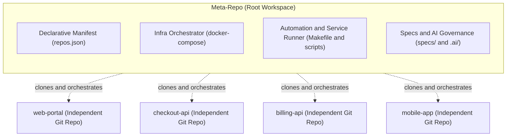

# Meta-Repo Architecture Reference (On-Demand)

> Architectural philosophy, adoption criteria, cross-repo design patterns, full command dictionary (including optional advanced Makefile commands), Windows compatibility, and alternative tools. Read on demand when evaluating fit, adding optional targets, or handling Windows/WSL2 setups.

## Contents

1. [Overview and Architectural Philosophy](#1-overview-and-architectural-philosophy)
2. [When to Adopt (Decision Criteria)](#2-when-to-adopt-decision-criteria)
3. [Structural Characteristics & Subproject Autonomy](#3-structural-characteristics--subproject-autonomy)
4. [Native Architectural Design Patterns](#4-native-architectural-design-patterns)
5. [Optional Advanced Makefile Commands](#5-optional-advanced-makefile-commands)
6. [Windows Compatibility](#6-windows-compatibility)
7. [Alternatives to Custom Scripts](#7-alternatives-to-custom-scripts)

---

## 1. Overview and Architectural Philosophy

On the spectrum between **Pure Monorepos** (all code in a single Git repository) and **Isolated Multi-repos** (dozens of independent repositories without orchestration), the **Meta-Repo** emerges as a pragmatic middle ground.



### What is the pattern?
A Meta-Repo is a central Git repository that contains no service business logic. Instead, it acts as the organization's **governance shell, local environment orchestrator, and technical specification hub**.

Unlike `git submodule` approaches (which frequently suffer from detached HEADs and pointer merge conflicts), the Meta-Repo adopts a **declarative manifest-based model**:
1. The root repository maintains a manifest (`repos.json`) listing repositories, paths, ports, categories, and remotes. **It is the single source of truth.**
2. The root `.gitignore` ignores the directories where subprojects are cloned.
3. Scripts automate cloning, updating, and integrity checks across all repositories.
4. An IDE workspace file connects all folders into a single navigation tree with global indexing.

---

## 2. When to Adopt (Decision Criteria)

Evaluate before implementing:

| Decision Question | Adopt Meta-Repo? | Notes |
| :--- | :---: | :--- |
| Do teams use heterogeneous technologies (Node, Go, Python, C#, PHP)? | **Yes** | Traditional monorepos struggle to integrate disparate build toolchains. |
| Do services have independent deploy lifecycles and ownership? | **Yes** | Each repository preserves its own CI/CD and permissions. |
| Do you need a reproducible development environment with a few commands? | **Yes** | The pattern eliminates onboarding friction. |
| Dozens of existing repositories cannot be merged (history, compliance, permissions)? | **Yes** | The meta-repo organizes them without migrating Git history. |
| Are all services TypeScript/JavaScript sharing dense code daily? | **No** | A pure monorepo with pnpm Workspaces + Turborepo/Nx is usually a better fit. |
| Are atomic cross-repo changes (a single commit touching multiple services) frequent and non-negotiable? | **No** | Consider a monorepo; a meta-repo relies on the Expand/Contract pattern (Section 4.1). |

---

## 3. Structural Characteristics & Subproject Autonomy

A modern Meta-Repo implements the following core capabilities:

* **Autonomy with True Decoupling**: Each service keeps its own lifecycle, CI/CD pipelines, access permissions, and versioning, without monorepo merge trains.
* **Conflict-Free Polyglot Stacks**: Services in heterogeneous languages and frameworks (Node.js, Go, Python, C#, React Native, Kubernetes manifests) coexist in the same development environment without dependency conflicts or a single forced build tool.
* **Hybrid Execution Environment**: Infrastructure and backend services run in Docker containers (OS parity), while frontends and mobile apps run natively on the host (low-latency hot-reload and lower resource usage).
* **Spec-Driven Engineering**: End-to-end technical specifications live centrally at the root (`specs/`), acting as the single source of truth for features spanning multiple services.
* **Centralized Organizational Documentation (`docs/`)**: High-level architecture views, ADRs (*Architecture Decision Records*), C4 diagrams, and operational runbooks, preventing holistic knowledge from scattering across individual repositories.
* **Native AI Governance (`AGENTS.md`, `CLAUDE.md`, and `.ai/`)**: Architectural rules, file size limits (LOC), coding standards, roles, and AI commands reside at the root and are distributed to tools like Claude Code, Windsurf, Cursor, and CLI assistants (see [entry-files.md](entry-files.md)).
* **Organization-Specific CLI**: A global command (e.g., `acme status`, `acme run`) that works from **any subdirectory**, interactively installed into the developer's shell.

### Subproject Autonomy Principle (Zero Lock-in)

> [!IMPORTANT]
> **The Meta-Repo is additive, never restrictive.** It adds a convenience layer for orchestration, governance, and integrated development, but **never strips away any property of a standalone repository**.

* **Every subproject works outside the meta-repo**: `git clone`, installing dependencies, and running the service must work in isolation without depending on the workspace folder layout.
* **Relative imports across repository boundaries are forbidden** (e.g., `import "../../libs/shared"`). Shared code is distributed via versioned packages or generated contracts (Section 4.2).
* **Optional IDE focus**: developers working on a single repository can open just that folder (`code apps/web-portal`) without loading the entire workspace.
* **Commits always happen at the subproject root**: a subproject's Git history never receives files from the meta-repo, and vice versa.

---

## 4. Native Architectural Design Patterns

### 4.1. Cross-Repo Changes (Expand/Contract Pattern)
Because there are no atomic commits spanning multiple repositories simultaneously, direct breaking changes to API contracts or database schemas are forbidden:

1. **Phase 1 (Expand)**: The producer service adds new fields or routes while maintaining full backward compatibility. Deployed to production in isolation.
2. **Phase 2 (Migrate)**: Consumer services are gradually updated to use the new version.
3. **Phase 3 (Contract)**: Obsolete code or fields are removed from the producer in a later cycle.

> [!TIP]
> **Branch Naming by Specification ID**: For features spanning multiple repositories, use the same branch name across all of them (e.g., `feat/SPEC-042-billing-overhaul`). That way, `make checkout BRANCH=...` switches the entire ecosystem at once, and CI automations can automatically link sibling branches.

### 4.2. Typed Contracts and Compile-Time Validation
* Publish contracts from a language-neutral specification (**OpenAPI**, **Protobuf/gRPC**, or **GraphQL**) and generate typed clients for each consumer stack (e.g., TypeScript types, Go structs).
* Shared libraries (e.g., `libs/shared`) are distributed as **versioned packages** in a registry, never via relative file paths.
* Result: contract breakages are caught during the consumer's static typecheck/compilation (`tsc`, `go build`) before deployment.

### 4.3. Resource Efficiency and Local Performance
* **Selective Cloning and Flexible Taxonomy**: Combine freely:
  * *By Product or Business Domain* (`product` field, e.g., `checkout`, `billing`): vertical squads clone only their product line (`make bootstrap-product PRODUCT=checkout`).
  * *By Technical Layer* (`category` field, e.g., `frontend`, `backend`, `library`, `iac`): engineers download only relevant layers (`make bootstrap-frontend`).
  * *By Lifecycle* (`legacy` category): legacy repositories are **excluded from the default bootstrap** and only cloned on demand (`make bootstrap-legacy`).
* **Content-Addressable Storage (CAS)**: Standardize on package managers that share global physical disk storage (such as `pnpm`), avoiding duplicate `node_modules` across repositories.
* **Language Server Optimization**: Configure `*.code-workspace` to exclude build and dependency folders from indexing and file watchers (see [entry-files.md](entry-files.md)).

### 4.4. Single Source of Truth (Manifest)
* **`repos.json` is the single source of truth.** The `Makefile` derives repository paths from the manifest; the service runner reads ports and execution modes directly from it.
* Other files (`.gitignore`, workspace `folders`, README port tables) are validated against the manifest by `make check-manifest`, running both locally and in CI.
* Convention: every service name in `docker-compose.dev.yml` matches the repository's `name` in the manifest.

### 4.5. Reproducibility (Version Pinning)
* Each manifest entry can declare `branch` (default working branch, defaults to `main`) and, optionally, `ref` (pinned tag or commit SHA).
* Use `ref` to freeze the ecosystem at a known state (e.g., reproducing a bug from release `v2.3`).
* Suggested advanced command: `make snapshot`, which records the current SHAs of all repositories into `repos.lock.json`, similar to Google's `repo manifest -r`.

> For **Companion IaC / Deploy Repositories (Parent Grouping Folder Pattern)**, see [blueprint.md](blueprint.md).

---

## 5. Optional Advanced Makefile Commands

> [!TIP]
> After configuring the organization CLI (`make setup-cli`), any `make <command>` can be invoked as `<cli> <command>` (e.g., `acme status`) from **any subdirectory**.
> All Essential Commands (`help`, `bootstrap*`, `install`, `setup-cli`, `remove-cli`, `check-manifest`, `run`, `dev-*`, `pull`, `status`, `branches`, `checkout`, `sync-main`, `exec`) are implemented and self-documented directly in [blueprint.md](blueprint.md).

Add the optional extensions below to the `Makefile` when tailored to the organization's workflow:

#### Advanced Git
| Command | What it does | Purpose | When to use |
| :--- | :--- | :--- | :--- |
| `make branch-new NAME=<name>` | Creates the same branch across participating repositories. | Standardize branch names on spec-driven features. | Starting a cross-repo feature. |
| `make prune-branches` | Runs `git remote prune origin` and deletes merged local branches. | Clean up stale branches across repos at once. | Weekly or end of sprint. |
| `make stash` / `make stash-pop` | Batch `git stash` / `git stash pop` across dirty repos. | Quickly save and restore ecosystem state. | Urgent hotfix interruptions. |
| `make dirty` | Lists only repositories with uncommitted changes or unpushed commits. | Focus strictly on repos currently being edited. | Before opening Pull Requests. |
| `make snapshot` | Writes current commit SHAs of all repos into `repos.lock.json`. | Reproduce the exact ecosystem state later. | Before releases or regression triage. |

#### Quality and Testing
| Command | What it does | Purpose | When to use |
| :--- | :--- | :--- | :--- |
| `make check` | Runs manifest `checks` (`lint`/`typecheck`/`test`) on dirty repos only. | Polyglot pre-commit verification. | Before opening or updating PRs. |
| `make test-e2e` | Starts required infrastructure and runs cross-service integration suites. | Validate real contracts and critical flows. | Before merging to main or releases. |

#### Databases
| Command | What it does | Purpose | When to use |
| :--- | :--- | :--- | :--- |
| `make db-migrate` | Runs pending migrations across services in dependency order. | Keep local schemas up to date. | After a `pull` with new migrations. |
| `make db-seed` | Populates local databases with consistent relational synthetic data. | Keep test IDs aligned across decoupled services. | Fresh databases or new flow testing. |
| `make db-reset` | Recreates local databases, reapplies migrations, and runs seeds. | Recover a clean transactional state. | Inconsistent local DB state. |

#### Configuration and Secrets
| Command | What it does | Purpose | When to use |
| :--- | :--- | :--- | :--- |
| `make env-check` | Compares each `.env` against `.env.example` and flags missing keys. | Catch newly added env vars early. | Right after `make pull`. |
| `make env-sync` | Pulls authorized dev env vars from a secret manager (Doppler, Infisical, Vault). | Populate credentials safely without chat sharing. | Onboarding or key rotation. |

#### Shared Packages
| Command | What it does | Purpose | When to use |
| :--- | :--- | :--- | :--- |
| `make link-local PKG=... TARGET=...` | Links a shared package into a consumer via `yalc` or `pnpm link`. | Test library changes live without publishing. | Evolving shared contracts or UI kits. |
| `make unlink-local` | Removes local links and restores official package versions. | Prevent ephemeral links from breaking CI. | Before committing and pushing. |

#### Diagnostics and Cleanup
| Command | What it does | Purpose | When to use |
| :--- | :--- | :--- | :--- |
| `make doctor` | Checks minimum tool versions (Node, Docker, Git, pnpm), RAM, registry access. | Catch local environment drift early. | Day-one setup or unexpected failures. |
| `make ports` | Checks whether manifest ports are free or in use on the host. | Locate zombie processes or port conflicts. | Before starting stack or `EADDRINUSE`. |
| `make clean` | Removes build artifacts (`dist/`, `.next/`, `.turbo/`) without removing deps/volumes. | Clear stale incremental caches. | Stale build cache issues. |
| `make purge` | Deep clean: removes `node_modules`, orphan volumes, caches, unused images. | Reclaim gigabytes of disk space. | Periodically or corrupted installs. |

#### AI Governance
| Command | What it does | Purpose | When to use |
| :--- | :--- | :--- | :--- |
| `make setup-ide` | Creates symlinks/configs for AI tools at root (e.g., `.claude/commands` → `.ai/workflows`). | Integrate workflows and rules with AI assistants. | After bootstrap or adding workflows. |
| `make setup-all` | Propagates AI governance configs to every subproject. | Standardize rules across the ecosystem. | After updating rules in `.ai/`. |
| `make ai-clean` | Removes generated symlinks and AI configuration artifacts. | Reset broken tool configurations. | Troubleshooting AI tool configs. |

---

## 6. Windows Compatibility

`make`, `bash`, symlinks, and utilities such as `lsof` are not natively available on Windows.

* **Recommended: WSL2.** Clone the meta-repo **inside the WSL filesystem** (e.g., `~/dev`, not `/mnt/c/...`) for full I/O performance and script compatibility. VS Code connects seamlessly via the *WSL* extension.
* **Alternative (Native PowerShell)**: install `make` (e.g., `winget install GnuWin32.Make` or via Scoop/Chocolatey) and add the CLI function manually to `$PROFILE`:
  ```powershell
  function acme { make --no-print-directory -C "C:\dev\acme-workspace" @args }
  ```
  In this mode, Makefile targets that rely on `bash` loops require Git Bash configured as `SHELL`. The Node scripts (`bootstrap`, `run`, `check-manifest`) run natively on Windows.

---

## 7. Alternatives to Custom Scripts

The bundled scripts are intentionally simple and zero-dependency. For larger setups, consider:

| Tool | Approach | When to consider |
| :--- | :--- | :--- |
| **git submodule** | Commit pointers versioned in the parent repo | When strict SHA pinning in parent history is required and the team is comfortable with submodule workflows. |
| **Google `repo`** | XML manifest with pinning and parallel sync | Ecosystems with hundreds of repositories (e.g., AOSP). |
| **`meta`** (npm) | `.meta` file + plugins (`meta git pull`, `meta exec`) | Node.js teams looking for an off-the-shelf CLI. |
| **`mani`** | YAML manifest with tags and custom tasks | Running tasks filtered by tags/projects without writing custom scripts. |
| **`gita`** | Python CLI for batch status and git commands | Lightweight status overview across many repositories. |
| **Nx / Turborepo** | Monorepo with dependency graph and build caching | When Section 2's decision criteria point toward a monorepo. |

> [!TIP]
> The `repos.json` manifest remains valuable even if you adopt one of these tools: it stays the single source of truth for ports, categories, verification commands, and config generation.
